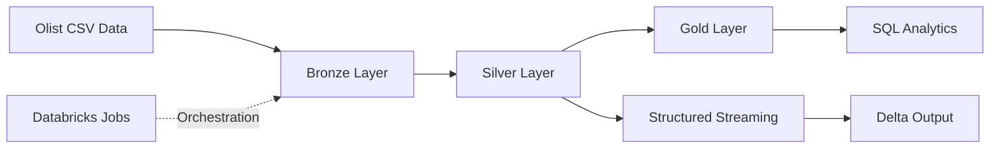
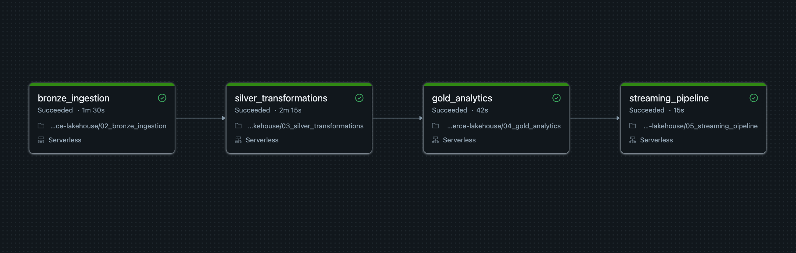

# E-Commerce Lakehouse: Real-Time Order Processing & Analytics

An end-to-end data engineering portfolio project built with Databricks, PySpark, Delta Lake, Spark Structured Streaming, Unity Catalog, and SQL using the Olist Brazilian E-Commerce dataset.

The project demonstrates a medallion lakehouse, data-quality handling, dimensional modelling, business analytics, and Databricks Jobs orchestration. Historical Olist orders are replayed as file-based events to demonstrate Structured Streaming; this is a simulation, not a live production feed.

## Architecture



## Pipeline Orchestration

The complete data pipeline is orchestrated using **Databricks Jobs & Workflows**, with four sequential tasks running on Serverless compute.



### Pipeline Workflow

1. **Bronze Ingestion:** Loads raw Olist CSV files into Delta tables.
2. **Silver Transformations:** Cleans, validates, and transforms the ingested data.
3. **Gold Analytics:** Builds analytical fact tables, dimension tables, and business metrics.
4. **Streaming Pipeline:** Processes simulated historical order events using Spark Structured Streaming.

All four tasks are connected through task dependencies and execute sequentially.

**Execution Status:** All four tasks completed successfully.

## Technology stack
- Databricks Free Edition / Serverless compute
- Apache Spark and PySpark
- Delta Lake and Unity Catalog
- Spark Structured Streaming
- Databricks Jobs & Workflows
- SQL

## Data source
The project uses the public Olist Brazilian E-Commerce dataset. Raw CSV files are not included; download them from the dataset provider and upload them to a Unity Catalog Volume.

## Medallion layers

### Bronze
Raw CSV ingestion into Delta tables with ingestion metadata and source-file lineage.

### Silver
Data cleaning, deduplication, key validation, and handling of invalid records. The corrected review dataset contains 99,224 records, zero null review IDs, and zero duplicate `(review_id, order_id)` combinations. The verified Silver geolocation output contains 738,332 records.

### Gold
The completed build produced these tables:

| Gold table | Rows |
|---|---:|
| dim_customers | 99,441 |
| dim_products | 32,951 |
| dim_sellers | 3,095 |
| dim_date | 634 |
| fact_orders | 99,441 |
| fact_order_items | 112,650 |
| daily_sales | 634 |
| seller_performance | 3,095 |
| delivery_performance | 2 |

## Streaming simulation
A bounded historical replay of 10,000 order events was consumed with Spark Structured Streaming and written to `workspace.bronze.order_events_stream`. The file source and `availableNow` trigger demonstrate streaming mechanics; this is not a live event integration.

## Workflow orchestration
Databricks Job: `ecommerce_lakehouse_pipeline`

1. `bronze_ingestion`
2. `silver_transformations`
3. `gold_analytics`
4. `streaming_pipeline`

The observed successful Serverless run completed in 4 minutes 45 seconds. This is a development run result, not a benchmark.

## Repository layout
```text
.
├── architecture/
├── docs/
├── notebooks/
├── sql/
├── tests/
├── README.md
└── .gitignore
```

## Running the project
1. Use a Databricks workspace with Unity Catalog.
2. Download the Olist CSV files and upload them to a Unity Catalog Volume.
3. Review workspace-specific catalog, schema, volume, and path settings in the notebooks.
4. Import notebooks from `notebooks/`.
5. Run exploration, Bronze, Silver, Gold, streaming, and SQL analytics notebooks.
6. Create the Databricks Job with the four pipeline notebooks and documented dependencies.

## Evidence
Add screenshots of the successful Job run, Gold table validation, streaming counts, and SQL results to `docs/screenshots/`.

## Future improvements
- Replace bounded historical replay with a continuously arriving event source.
- Add incremental CDC ingestion and idempotent MERGE operations.
- Add automated quality alerts and a BI dashboard.

## Author
**Ritu Shree** | Information Science and Engineering
